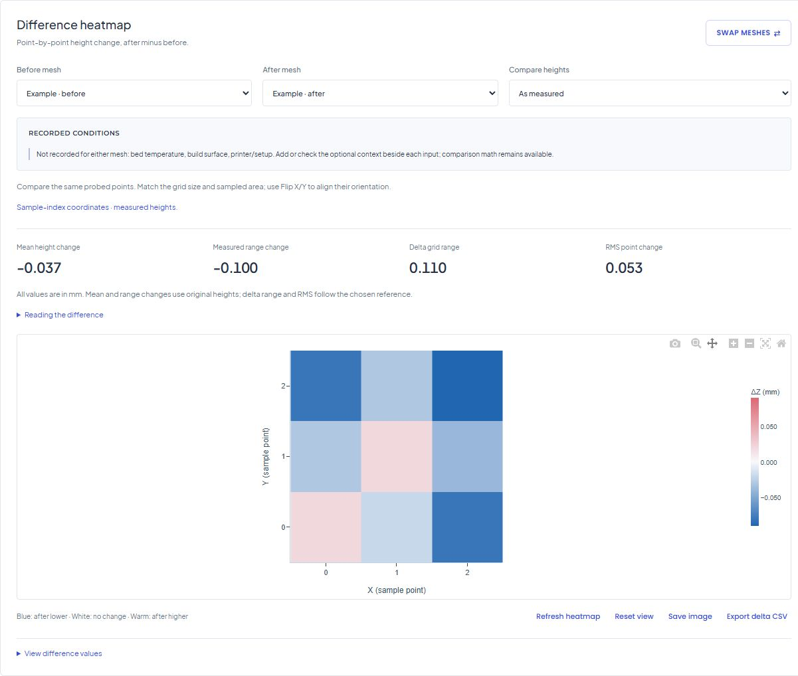

# Bed Mesh

I made Bed Mesh to see what the numbers from my 3D printer actually looked like. Paste a mesh at [bedmesh.com](https://bedmesh.com/), and you can see where the bed is high or low on a heatmap or a 3D plot.

If you’ve just adjusted the bed or swapped a plate, put the two scans side by side. The difference heatmap shows what changed at each point. If the printer gives you a slightly different mesh every time, you can compare a few runs from before the adjustment to see how much the readings normally move.

Open the [visualizer](https://bedmesh.com/#visualizer) and hit **Try example** to see a mesh, or open the [calibration walkthrough](https://bedmesh.com/?demo=comparison) to see what changed between scans.



## Get a mesh from your printer

Bed Mesh reads Marlin `G29` reports, Klipper Z matrices, and `G81` output from supported Prusa firmware. You can also paste a grid of numbers or import a text, CSV, or JSON file. If your console log has several scans in it, use **Scan a printer log** to pick the one you want. The [firmware guide](https://bedmesh.com/guides/?topic=getting-mesh-data#firmware-output) shows where to find the output for each firmware.

The visualizer runs in your browser and saves your workspace there. You can download the original values as CSV, save a chart as PNG, or export a comparison report with both scans and the cross-sections. If you want to move to another browser, download a workspace or history backup first.

Usage analytics on bedmesh.com starts only if you opt in. Mesh values, notes, and filenames stay in your browser.

## Run it locally

You’ll need PHP 8.1 or newer and a browser. There’s no build step or database setup for the visualizer and guides.

```sh
php scripts/serve.php
```

Open [http://127.0.0.1:8765](http://127.0.0.1:8765). The [journal](blog/README.md) has a separate MySQL setup. If you’re hosting a copy, see the [deployment notes](docs/DEPLOYMENT.md).

To run the same checks as GitHub Actions, you’ll also need Git, Node.js 18+, and Python 3.

```sh
php scripts/check-release.php
```

## Found a bug?

[Open an issue](https://github.com/Rahyan/BedMeshVisualizerWebsite/issues/new) and include your printer model, firmware version, and a few lines of the mesh that reproduce it. A small excerpt is usually enough. Leave out anything from the log you’d rather keep private.
